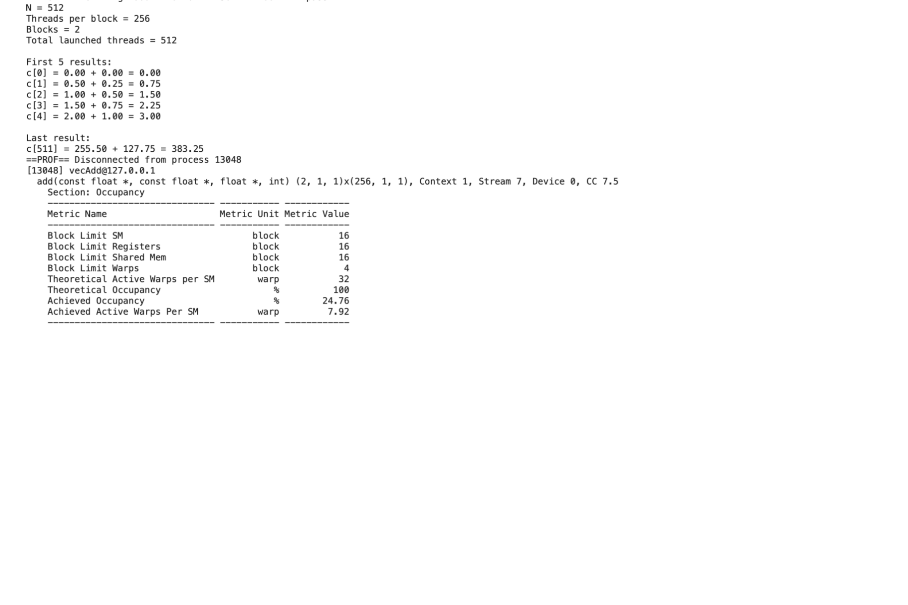
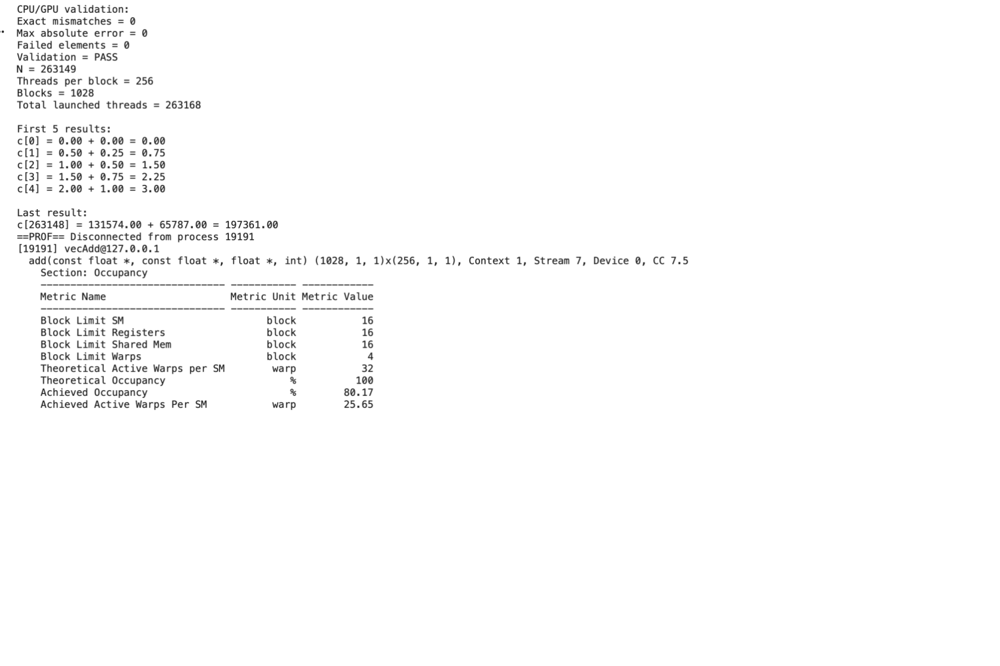
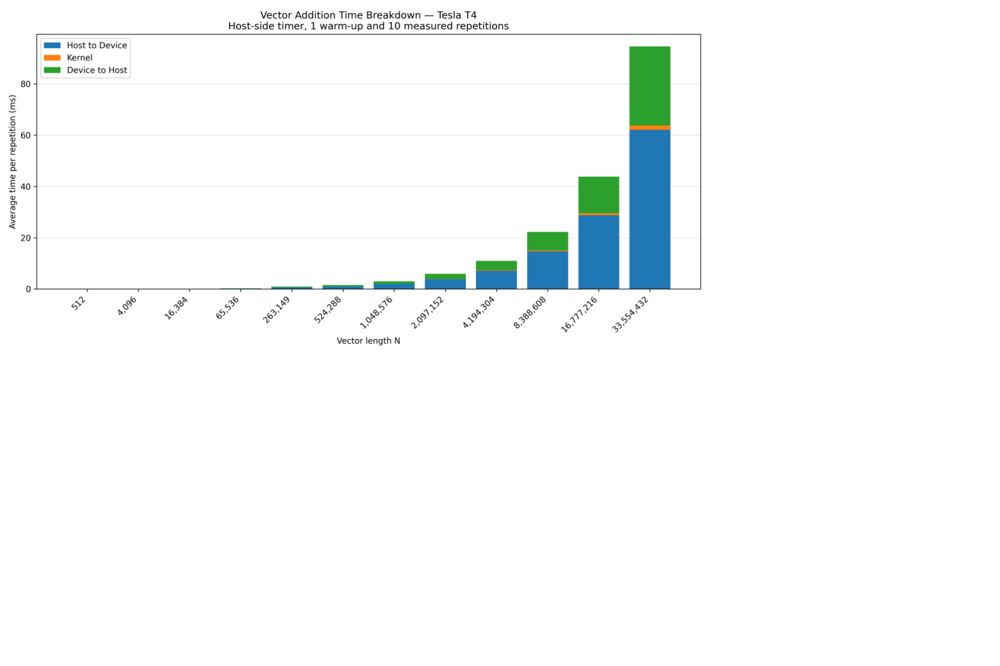
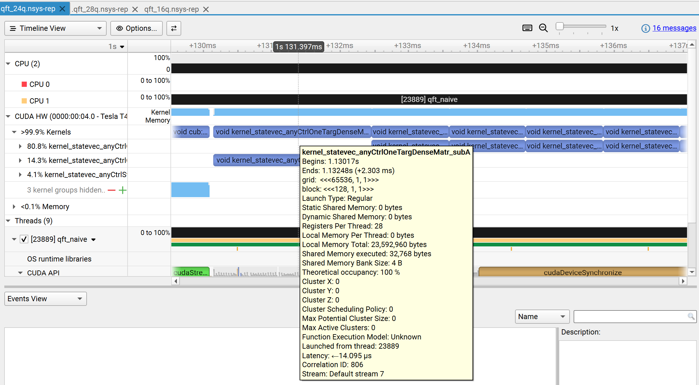
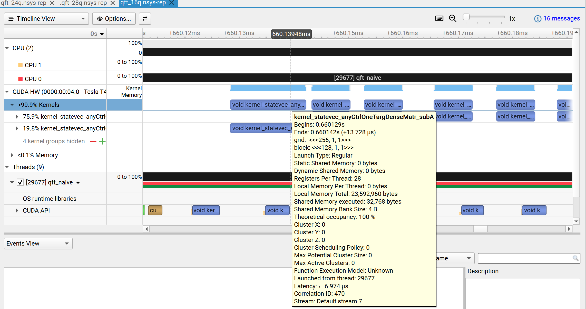
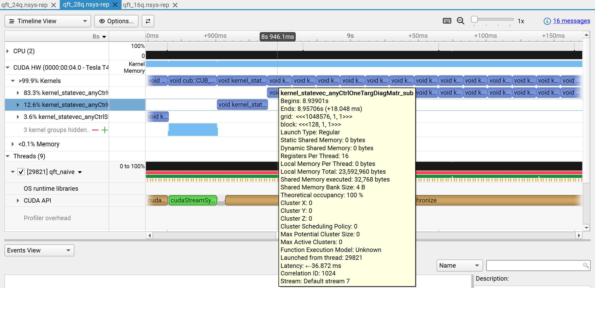

# HW1 Group 18

*DD2360/FDD3360 Applied GPU Programming*

# Question 1 – Vector Addition

Experiments were performed on a Tesla T4 GPU using Google Colab. The implementation uses float data and 256 threads per block.

### 1. Floating point operations and global memory reads

For a vector of length N, the kernel executes `c[i] = a[i] + b[i]` for each element.

Therefore, the number of floating-point operations is **N**, and the number of global memory reads is **2N**.

Additionally, the kernel performs N global memory writes to store the results.

### 2. Threads and blocks for N equal to 512

For N = 512, this implementation uses 256 threads per block.

The number of blocks is:

\[
\text{Blocks} = \left\lceil \frac{512}{256} \right\rceil = 2
\]

Therefore, **2 blocks and 512 CUDA threads** are launched.

### 3. Achieved occupancy for N equal to 512

The achieved occupancy was measured using Nsight Compute.

**Achieved Occupancy = 24.76%.**



*Figure 1. Nsight Compute output for N = 512.*

### 4. Correctness for N equal to 263149

The program still runs correctly, and no modifications are required.

The boundary check ensures that threads with indices beyond the vector length do not access invalid memory locations.

### 5. Threads and blocks for N equal to 263149

The number of blocks is:

\[
\text{Blocks} = \left\lceil \frac{263149}{256} \right\rceil = 1028
\]

The total number of launched threads is:

\[
1028 \times 256 = 263168
\]

Therefore:

- **Blocks:** 1028
- **Threads per block:** 256
- **Total threads:** 263168

The additional 19 threads do not perform vector additions because their indices exceed the vector length.

### 6. Achieved occupancy for N equal to 263149

The achieved occupancy was measured using Nsight Compute.

**Achieved Occupancy = 80.17%.**



*Figure 2. Validation and Nsight Compute output for N = 263149.*

### 7. Time breakdown for different vector lengths

Twelve vector lengths were tested. For each length, one warm-up was followed by 10 measured repetitions.

The figure shows the average host-side time for copying both input vectors from host to device, executing the CUDA kernel, and copying the output vector from device to host.

The three measured operations are:

1. **Host-to-Device (H2D):** Copying both input vectors from CPU memory to GPU memory.
2. **Kernel Execution:** Performing vector addition on the GPU.
3. **Device-to-Host (D2H):** Copying the output vector from GPU memory back to CPU memory.

The CPU timer uses `gettimeofday`, as in the course tutorial. Kernel timing includes launch and synchronization overhead.

Memory allocation, initialization, CPU reference computation, and result validation are excluded from the three timed regions.



*Figure 3. Mean H2D, kernel, and D2H times for 12 vector lengths on the Tesla T4.*

### 8. Comparison of CPU and GPU results

The calculation results of CPU and GPU are exactly the same in this experiment.

Both implementations use the same float data type and perform the same element-wise addition. Although the GPU uses multiple threads, each thread independently computes one output element without affecting the calculations of other threads.

Therefore, the CPU and GPU implementations produce identical results for the tested inputs.

---

# Question 3 – Quantum Fourier Transformation

### 1. Do you need any troubleshooting to get the QFT benchmark running on GPU? Include a screenshot of your run output of 24 qubits QFT.

**Troubleshooting:** Initially, CMake failed because the commands were executed in `/content` instead of the QuEST project directory. This was resolved by explicitly specifying the source directory using `cmake -S /content/QuEST -B /content/QuEST/build`.

After this correction, QuEST was successfully compiled with CUDA acceleration enabled.

**Results:** The 24-qubit QFT benchmark ran successfully on the GPU with 5 timed repetitions. The state vector occupied 0.25 GiB, with 312 quantum gates per QFT. The best execution time was 385.173 ms, and the mean was 385.250 ms. The final total probability was 1.000000000000.

The benchmark was compiled and executed using the following commands:

```bash
cd /content/QuEST

cp /content/qft_bench_naive.c qft_bench_naive.c

cmake -S /content/QuEST -B /content/QuEST/build \
  -DQUEST_ENABLE_CUDA=ON \
  -DCMAKE_CUDA_ARCHITECTURES=75 \
  -DCMAKE_CUDA_FLAGS="-lineinfo" \
  -DUSER_SOURCE_NAMES=qft_bench_naive.c \
  -DUSER_OUTPUT_EXE_NAME=qft_naive

cmake --build build -j4

./build/qft_naive 24 5
```

The benchmark output was:

```text
QFT benchmark: 24 qubits, 5 reps, GPU backend, 0.25 GiB state vector
  rep 0:  385.173 ms
  rep 1:  385.250 ms
  rep 2:  385.222 ms
  rep 3:  385.275 ms
  rep 4:  385.328 ms
  total prob    : 1.000000000000

  gates per QFT : 312
  best / mean   : 385.173 / 385.250 ms
  time per gate : 1234.528 us
```


*Figure 4. Successful execution of the 24-qubit QFT benchmark on the Tesla T4 GPU.*

### 2. Run the benchmark again using 28 qubits. How much GPU memory and system memory are used during the execution? Explain how you obtained the memory usage.

The QFT benchmark was executed with 28 qubits and 5 timed repetitions on the CUDA backend.

The measured peak GPU memory usage was **4203 MiB (approximately 4.10 GiB)**, while the peak system memory usage of the benchmark process was **183,492 KiB (approximately 179.2 MiB)**.

GPU memory usage was measured by repeatedly sampling `nvidia-smi --query-gpu=memory.used` at approximately 100 ms intervals during execution. The GPU memory usage before execution was 0 MiB.

System memory usage was measured using `/usr/bin/time -v`, which reports the maximum resident set size (RSS) of the process.

The theoretical memory required for a 28-qubit double-precision state vector is:

\[
2^{28} \times 16\text{ bytes} = 4\text{ GiB}
\]

The measured GPU memory usage was slightly higher than this theoretical value, likely due to CUDA runtime overhead and additional GPU allocations.

The relatively low host memory usage indicates that the state vector was primarily stored in GPU memory.

### 3. Use only Nsight Systems and the unmodified benchmark. Record a timeline at 24 qubits with 5 timed repetitions. Report the top 3 kernels by total time, with their instance counts and average durations.

The benchmark was profiled using the following command:

```bash
nsys profile --trace=cuda,osrt --stats=true \
  -o qft_24q ./build/qft_naive 24 5
```

The 24-qubit QFT benchmark was profiled using Nsight Systems with CUDA and OS runtime tracing enabled.

According to the `cuda_gpu_kern_sum` report, the top three GPU kernels ranked by total execution time were:

| Kernel | Total Time (ms) | Instances | Average Duration (µs) |
|---|---:|---:|---:|
| `kernel_statevec_anyCtrlOneTargDiagMatr_sub` | 1891.753 | 1656 | 1142.363 |
| `kernel_statevec_anyCtrlOneTargDenseMatr_subA` | 335.208 | 144 | 2327.833 |
| `kernel_statevec_anyCtrlSwap_subA` | 96.364 | 72 | 1338.386 |

The diagonal-matrix kernel accounted for approximately **80.8%** of the total GPU kernel execution time, making it the dominant performance hotspot.

Although the dense-matrix kernel had a longer average execution duration, the diagonal-matrix kernel consumed more total time because it was launched much more frequently.

The instance counts include both the five timed repetitions and one warm-up execution.

### 4. Map each of the 3 top kernels to the quantum gate using the kernel names and `quest/src/gpu/gpu_kernels.cuh`. List the kernel name that implements these quantum gates.

Based on the kernel names and the operations performed by the QFT benchmark, the three dominant GPU kernels correspond to the following quantum gates:

| GPU Kernel | Quantum Gate | QuEST API |
|---|---|---|
| `kernel_statevec_anyCtrlOneTargDiagMatr_sub` | Two-Qubit Phase Shift | `applyTwoQubitPhaseShift()` |
| `kernel_statevec_anyCtrlOneTargDenseMatr_subA` | Hadamard | `applyHadamard()` |
| `kernel_statevec_anyCtrlSwap_subA` | SWAP | `applySwap()` |

The diagonal-matrix kernel performs phase-related operations, while the dense-matrix kernel applies the Hadamard transformation. The swap kernel exchanges the relevant state-vector amplitudes.

For 24 qubits, each QFT contains 276 phase-shift gates, 24 Hadamard gates, and 12 SWAP gates.

Since the profiling includes one warm-up and five timed repetitions, the expected kernel counts are 1656, 144, and 72, respectively, matching the Nsight Systems results.

### 5. Open the nsys-rep in the Nsight Systems GUI. Zoom into one QFT repetition on the timeline. Find the CUDA API calls on the CPU thread that launch the kernels.

The `qft_24q.nsys-rep` report was opened in the Nsight Systems GUI, and the timeline was zoomed into an individual QFT repetition.

The CPU-side CUDA API trace showed kernel launch operations corresponding to the GPU kernels.

For example, the Hadamard operation was associated with `kernel_statevec_anyCtrlOneTargDenseMatr_subA`, with a CPU-side launch duration of **14.039 µs**, a launch latency of **14.095 µs**, and Correlation ID **806**.

The CUDA kernel launches are asynchronous, meaning the CPU can return from the launch call before the GPU finishes executing the kernel.

The CPU launch operations can be matched to their corresponding GPU executions using the correlation information provided by Nsight Systems.



*Figure 5. Nsight Systems timeline showing the CPU-side CUDA kernel launcher and GPU execution for the 24-qubit QFT benchmark.*

### 6. Repeat the recording at 16 and 28 qubits. For each, what is the total QFT time printed by the benchmark? What is the typical kernel duration as seen on the timeline? Include two screenshots of your two timelines.

The QFT benchmark was profiled using Nsight Systems at 16 and 28 qubits, with five timed repetitions for each configuration.

| Qubits | Best QFT Time (ms) | Mean QFT Time (ms) | Typical Phase-Shift Kernel Duration |
|---|---:|---:|---:|
| 16 | 1.741 | 1.911 | 6.948 µs |
| 28 | 8177.909 | 8189.069 | 18.153 ms |

The typical kernel duration was estimated using the average execution time of `kernel_statevec_anyCtrlOneTargDiagMatr_sub`, the most frequently executed kernel, as reported by Nsight Systems.

The mean QFT execution time increased by approximately **4,285 times** when scaling from 16 to 28 qubits.

This substantial increase is consistent with the exponential growth of the state-vector size, from \(2^{16}\) to \(2^{28}\) complex amplitudes.

The GPU kernel duration also increased significantly because each quantum gate operates on a much larger state vector.

**16-qubit timeline:**



*Figure 6. Nsight Systems timeline for the 16-qubit QFT benchmark.*

**28-qubit timeline:**



*Figure 7. Nsight Systems timeline for the 28-qubit QFT benchmark.*
