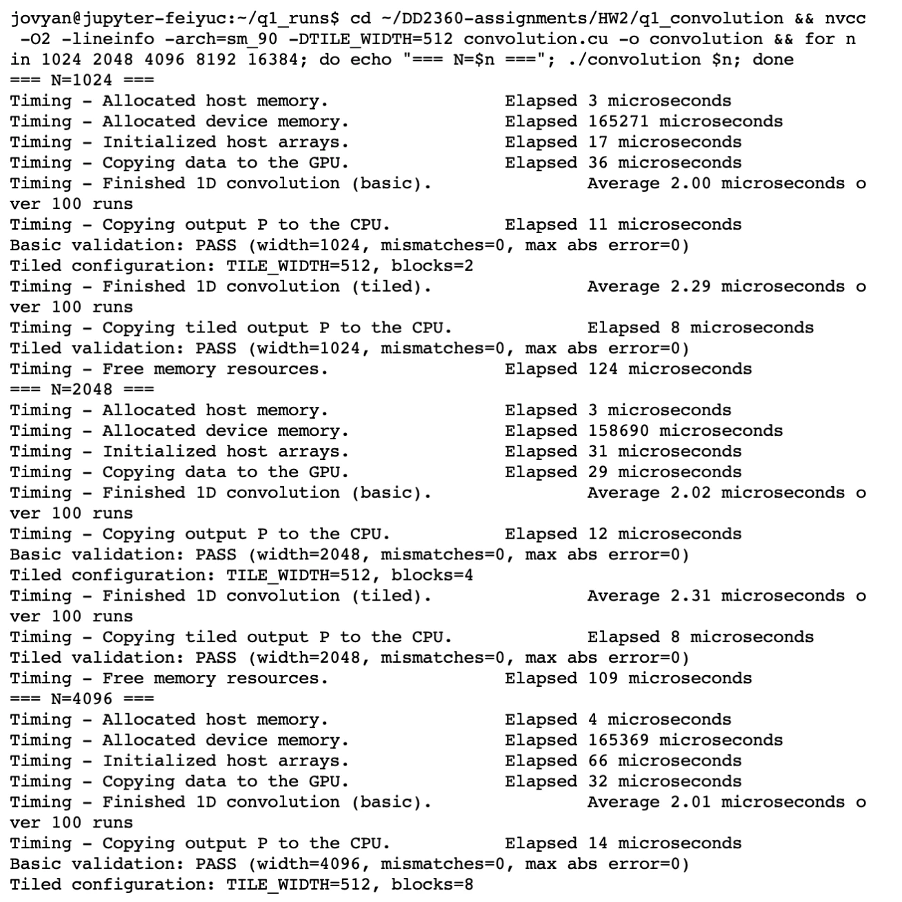
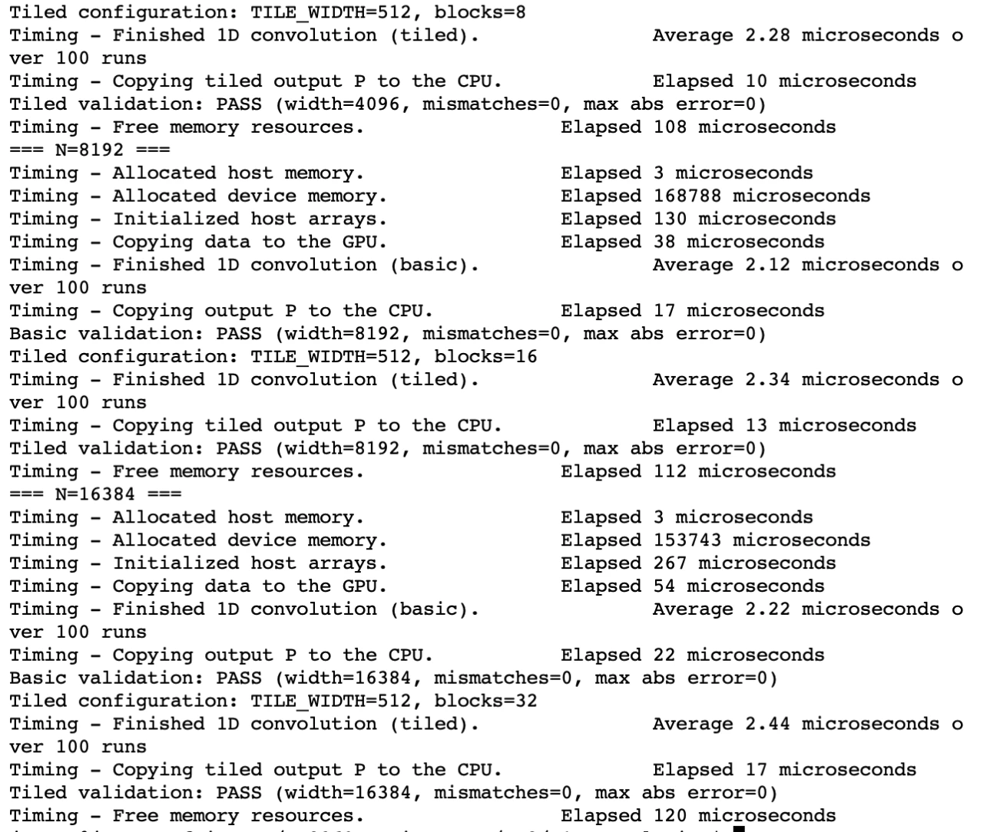

# Question 1  1D Convolution

Experiments were performed on one MIG instance of an NVIDIA H100 GPU (16 SMs) using the KTH JupyterLab server. The basic kernel uses 256 threads per block, and the tiled kernel uses TILE_WIDTH threads per block. Each kernel is run once as a warm-up, and then the average time of 100 runs is reported.

## Q1.1  Application domains of convolution

Convolutions are used in image processing, signal processing, and deep learning (convolutional neural networks, CNNs).

## Q1.2  Global memory reads and writes

Basic implementation: each thread reads 5 elements of N and 5 elements of M, and writes 1 element of P. The out-of-boundary elements are not read, and there are 6 of them at the two ends. Therefore, there are 5N − 6 reads of N, 5N − 6 reads of M, and N writes.

Tiled implementation: each block reads its tile and 2 halo elements on each side, so TILE_WIDTH + 4 elements of N. The halo elements between two blocks are read twice. With B = ceil(N / TILE_WIDTH) blocks, there are N + 4(B − 1) reads of N, 5N reads of M, and N writes.

For example, for N = 16384 and TILE_WIDTH = 512, the reads of N are 81914 in the basic kernel and 16508 in the tiled kernel.

## Q1.3  Results for different N and choice of tile size

Figure 1. Output for N = 1024, 2048, 4096, 8192 and 16384 with TILE_WIDTH = 512.

Both kernels give correct results for all N. The measured times are about 2 to 2.5 microseconds and almost do not change with N. I think this is because the kernels are very short, so the time is mostly the launch overhead.

Because of this, I used Nsight Systems to choose the tile size. I tested TILE_WIDTH = 32, 64, 128, 256, 512 and 1024 with N = 16384. The tiled kernel took 2363, 2012, 1657, 1585, 1564 and 1618 ns. TILE_WIDTH = 512 was the fastest, so I chose 512.

The basic kernel took about 1288 ns, so the tiled kernel is slower in this experiment. I think the reason is that the data is small and fits in the cache, so the shared memory does not save much time.

## Q1.4  Profiling the tiled implementation

Nsight Systems shows that cudaMalloc takes 99.3% of the CUDA API time, because the first CUDA call also creates the CUDA context. One kernel launch takes about 3 microseconds, which is longer than the tiled kernel itself (about 1.6 microseconds). Therefore, the hotspot is the setup and the kernel launch, not the convolution. Inside the kernel, the main stall is waiting for global memory.

Shared memory utilization is low. Each block uses 2.06 KB of shared memory, the shared memory pipe is used at 3.30% of peak, and there are no bank conflicts.

Theoretical occupancy is 100%, and achieved occupancy is 48.06%. I think this is because N = 16384 is too small. There are only 32 warps per SM, but one SM can have 64 warps.

Adjusting the shared memory capacity does not help. The number of blocks per SM is limited by registers and warps (4 blocks), not by shared memory (10 blocks). Also, a larger shared memory makes the L1 cache smaller. I did not test this directly, so this conclusion is based on the profiling results.
