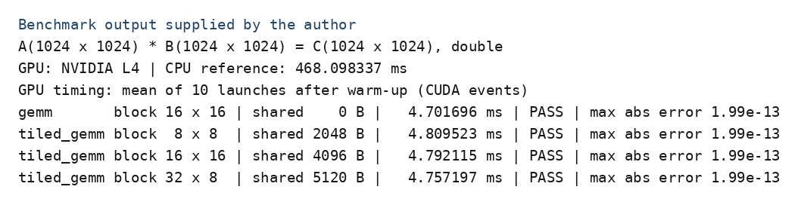
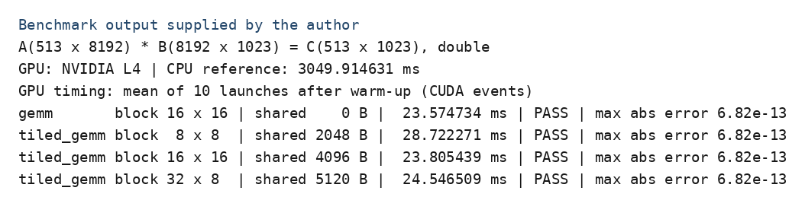
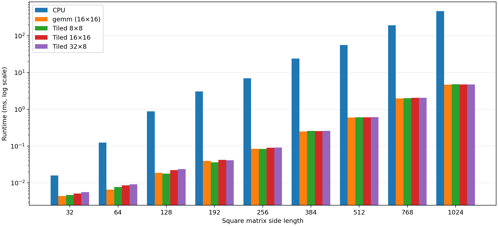

# Question 2 — Tiled Matrix Multiplication

The program computes $C_{M\times N}=A_{M\times K} B_{K\times N}$. The basic `gemm()` uses a 16 × 16 thread block and reads the operands from global memory. In `tiled_gemm()`, each block computes a `tileX`-wide by `tileY`-high output tile. It advances along $K$ in steps of 16. The block stages a `tileY × 16` slice of $A$ and a `16 × tileX` slice of $B$ in dynamic shared memory. Threads synchronize after each load and again before replacing those slices. Out-of-range inputs are zero-filled, and only valid output coordinates are written.

Both kernels use FP64 by default, matching the default in Assignment 1. The CPU reference is single-threaded and traverses rows of $B$ contiguously. It computes the full result once per input, and each GPU result is checked element by element against it. In benchmark mode, the CPU time covers computation, and GPU time is measured with CUDA events over 10 launches after warm-up. Allocation, transfers, and validation are outside the GPU timing interval.

## 1. Global memory reads

The basic kernel computes $MN$ outputs and issues $K$ reads from each input for each output, for $2MKN$ scalar reads. In the tiled kernel, each valid element of $A$ is fetched once per output block column and each valid element of $B$ once per output block row. The number of scalar reads is

$$MK\left\lceil\frac{N}{\mathrm{tileX}}\right\rceil + KN\left\lceil\frac{M}{\mathrm{tileY}}\right\rceil.$$

These counts describe global loads at the source level. Cache reuse and coalescing affect the corresponding hardware transactions. Both kernels write $MN$ outputs.

| Kernel and block (X × Y) | 1024 × 1024 × 1024 reads | 513 × 8192 × 1023 reads | Requested shared memory per block (FP64) |
|---|---:|---:|---:|
| Basic 16 × 16 | 2,147,483,648 | 8,598,306,816 | 0 B |
| Tiled 8 × 8 | 268,435,456 | 1,082,646,528 | 2,048 B |
| Tiled 16 × 16 | 134,217,728 | 545,513,472 | 4,096 B |
| Tiled 32 × 8 | 167,772,160 | 679,206,912 | 5,120 B |

The reduction in source-level reads ranges from 8× to 16× for the square input and from about 7.94× to 15.76× for the rectangular input. The 16 × 16 tile has the fewest loads for both shapes.

## 2. Square benchmark

The benchmarks ran in Colab on an NVIDIA L4 (compute capability 8.9, 58 SMs). The program uses FP64. The correctness check with A(17 × 19) and B(19 × 23) passed for all four GPU kernels with a maximum absolute error of 1.33 × 10⁻¹⁵, exercising partial tiles along all three dimensions.

*Figure 1. Rendered transcript of the supplied benchmark output for the square input.*

| Implementation | Runtime (ms) | Change in runtime vs. basic GPU |
|---|---:|---:|
| CPU | 468.098337 | |
| Basic 16 × 16 | 4.701696 | |
| Tiled 8 × 8 | 4.809523 | +2.29% |
| Tiled 16 × 16 | 4.792115 | +1.92% |
| Tiled 32 × 8 | 4.757197 | +1.18% |

All four GPU outputs passed, with a maximum absolute error of 1.99 × 10⁻¹³. The basic GPU kernel was about 99.6× faster than the single-threaded CPU reference on compute time. The 32 × 8 tile was fastest among the tiled kernels even though it issued 25% more source-level global loads than the 16 × 16 tile. In a 32 × 8 block, a warp spans a full output row within the tile, changing the warp's shared memory access pattern. Cache reuse in basic GEMM and the cost of shared memory staging and two barriers per stage in tiled GEMM could also contribute. The timing gaps are small, and the collected counters leave the contribution of each effect undetermined.

## 3. Rectangular benchmark

*Figure 2. Rendered transcript of the supplied benchmark output for the rectangular input.*

| Implementation | Runtime (ms) | Change in runtime vs. basic GPU |
|---|---:|---:|
| CPU | 3049.914631 | |
| Basic 16 × 16 | 23.574734 | |
| Tiled 8 × 8 | 28.722271 | +21.83% |
| Tiled 16 × 16 | 23.805439 | +0.98% |
| Tiled 32 × 8 | 24.546509 | +4.12% |

All four GPU outputs passed, with a maximum absolute error of 6.82 × 10⁻¹³. The basic GPU kernel was about 129.4× faster than the CPU reference on compute time. The 16 × 16 tile was the fastest tiled variant. With $K=8192$, every tiled block executes 512 stages, including the final block row with only one valid output row per block. The 8 × 8 variant launches 8,320 blocks compared with 2,112 for the 16 × 16 variant and issues about 1.98× as many global element reads. Each block performs its own staging and synchronization. This extra work offers an explanation for the 8 × 8 slowdown despite similar achieved occupancy across tile shapes.

## 4. Nsight Compute

Both runs collected Launch Statistics and Occupancy. The shared memory column gives the kernel-requested dynamic allocation per block. Nsight displays these values as 0 B, 2.05 kB, 4.10 kB, and 5.12 kB after rounding. All launches used zero static shared memory, and Nsight reported about 1.02 kB of driver shared memory per block in addition to the kernel allocation.

| Input (M × K × N) | Kernel | Achieved occupancy | Theoretical occupancy | Registers/thread | Dynamic shared memory/block |
|---|---|---:|---:|---:|---:|
| 1024 × 1024 × 1024 | Basic 16 × 16 | 97.32% | 100% | 40 | 0 B |
| | Tiled 8 × 8 | 81.73% | 83.33% | 48 | 2,048 B |
| | Tiled 16 × 16 | 81.79% | 83.33% | 48 | 4,096 B |
| | Tiled 32 × 8 | 81.79% | 83.33% | 48 | 5,120 B |
| 513 × 8192 × 1023 | Basic 16 × 16 | 94.45% | 100% | 40 | 0 B |
| | Tiled 8 × 8 | 80.49% | 83.33% | 48 | 2,048 B |
| | Tiled 16 × 16 | 80.59% | 83.33% | 48 | 4,096 B |
| | Tiled 32 × 8 | 80.51% | 83.33% | 48 | 5,120 B |

For the three tile shapes, the register limits are 20, 5, and 5 blocks per SM, equivalent to 40 active warps out of 48 in each configuration. The shared memory limits are 21, 12, and 10 blocks per SM, so registers set the theoretical occupancy for all three tiled variants. Achieved occupancy stays close to the theoretical ceiling.

Nsight warned that GPU frequencies were unlocked. The application's single-launch event times under profiling were much higher than the ordinary benchmark times. For example, the application reported 485.46 ms for square basic GEMM under profiling, compared with 4.70 ms in the ordinary run. Sections 2 and 3 use timing collected with the profiler detached.

[Square Nsight report](q2_results/ncu_1024_1024_1024.ncu-rep) · [Rectangular Nsight report](q2_results/ncu_513_8192_1023.ncu-rep)

## 5. Runtime sweep

*Figure 3. Compute time on a logarithmic axis for nine square sizes. Each group shows the CPU baseline and all four GPU variants.*

The CPU time rises from 0.015907 ms at size 32 to 466.274240 ms at size 1024. Basic GEMM rises from 0.004403 ms to 4.702003 ms over the same range. Its compute-only speedup over the CPU increases from 3.6× to 99.2×. Basic GEMM had the shortest measured GPU time at six of the nine sizes. The 8 × 8 tile led at 128, 192, and 256, with about 4.9%, 7.5%, and 1.7% lower runtime, respectively. Each GPU data point is a ten-launch average. Run-to-run variability was not measured.

The surprising result is that large reductions in source-level global loads produced no tiled speedup on either required input. Profiling also shows that the tiled variants have nearly identical achieved occupancy for each shape even though their runtimes differ, especially for the rectangular 8 × 8 tile. Load counts and occupancy alone therefore give an incomplete prediction of the ranking. The collected sections establish the register limit and occupancy. Quantifying the contributions of cache reuse, shared memory traffic, synchronization, or FP64 throughput would require additional counters.

[Raw timing CSV](q2_results/timings.csv)
