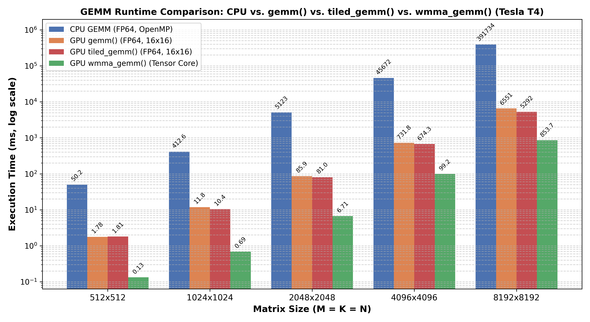

# Bonus Exercise: Tensor Core Accelerated Matrix Multiplication (CUDA WMMA)

## Implementation Summary
Building upon our Assignment 2 double-precision `gemm()` and `tiled_gemm()` implementation (`matMul.cu`), we added a GPU precision-conversion kernel (`convert_to_half`) and a mixed-precision Tensor Core kernel (`wmma_gemm`) using the CUDA `nvcuda::wmma` API on a Google Colab NVIDIA Tesla T4 GPU (`sm_75`, Turing architecture). Input matrices $A$ and $B$ (initialized as `double`) are converted on the GPU to IEEE 754 FP16 (`half`). Each warp computes one $16 \times 16$ output tile of $C$ by iterating over the $K$ dimension in steps of 16: loading $A$ and $B$ tiles into FP16 fragments (`wmma::load_matrix_sync`), executing Tensor Core matrix multiply-accumulate (`wmma::mma_sync`) into an FP32 (`float`) accumulator fragment, and storing the result to global memory (`wmma::store_matrix_sync`).

---

## Question 1: Fragment Dimensions and Total Fragment Count
Running the program with $A(1024 \times 2048)$ and $B(2048 \times 1024)$ produces $C(1024 \times 1024)$ ($M = 1024$, $K = 2048$, $N = 1024$):

* **Dimension of Fragments in Use:** We use the Turing FP16-input / FP32-accumulator WMMA shape of **$16 \times 16 \times 16$** (`WMMA_M = 16`, `WMMA_N = 16`, `WMMA_K = 16`). Each fragment (`aFrag`, `bFrag`, `cFrag`) therefore holds a $16 \times 16$ sub-matrix (256 elements).
* **Tile Grid Breakdown:**
  * Tiles along $M$: $1024 / 16 = 64$
  * Tiles along $N$: $1024 / 16 = 64$
  * Tiles along $K$: $2048 / 16 = 128$
* **Total Fragments Used:**
  * **Distinct Matrix Tiles:** $A$ has $64 \times 128 = 8,192$ tiles, $B$ has $128 \times 64 = 8,192$ tiles, and $C$ has $64 \times 64 = 4,096$ accumulator tiles, totaling **$20,480$ distinct tiles**.
  * **Total Warp-Level Fragment Operations/Loads:** Across the $4,096$ active warps (one warp per $16 \times 16$ output tile of $C$), each warp allocates $1$ `cFrag` accumulator and loads $128$ `aFrag` and $128$ `bFrag` fragments across the $K$-loop. This results in $524,288$ loads of `aFrag`, $524,288$ loads of `bFrag`, and $4,096$ `cFrag` accumulators—a total of **$1,052,672$ fragment operations**.

---

## Question 2: Nsight Compute Profiling and Effect of Threads per Block
We profiled `wmma_gemm()` on $A(1024 \times 2048) \times B(2048 \times 1024)$ using Nsight Compute (`ncu`) on the Tesla T4 GPU while varying the block size from 32 to 1024 threads per block:

| Threads / Block | Warps / Block | Grid Size | Kernel Duration (`gpu__time_duration.sum`, ms) | Tensor Pipe Cycles Active (`sm__pipe_tensor_op_hmma_cycles_active`, %) | Tensor Pipe Inst Executed (`sm__inst_executed_pipe_tensor_op_hmma`, %) | Achieved Occupancy (`sm__warps_active`, %) |
| :---: | :---: | :---: | :---: | :---: | :---: | :---: |
| 32 | 1 | 4096 | 3.12 | 6.01% | 2.93% | 48.59% |
| 64 | 2 | 2048 | 3.12 | 6.02% | 2.93% | 89.20% |
| 128 | 4 | 1024 | 3.18 | 6.02% | 2.93% | 90.03% |
| 256 | 8 | 512 | 3.12 | 6.03% | 2.95% | 88.90% |
| 512 | 16 | 256 | 3.12 | 6.18% | 3.02% | 92.73% |
| 1024 | 32 | 128 | 3.37 | 6.17% | 3.01% | 96.51% |

**Observations:**
1. **Occupancy vs. Tensor Core Utilization:** Increasing the block size from 32 to 64+ threads/block nearly doubles achieved warp occupancy (`48.59%` $\rightarrow$ `89.20%–96.51%`) because Turing SMs allow at most 16 resident blocks per SM (limiting 1-warp blocks to 16 warps/SM, or 50% theoretical occupancy out of 32 max warps/SM).
2. **Minimal Change in Tensor Core Utilization (~6.01%–6.18%):** Despite the large jump in occupancy, Tensor Core utilization (`sm__pipe_tensor_op_hmma_cycles_active`) increases only marginally from `6.01%` to `6.18%` (peaking at 512 threads/block), and kernel duration remains nearly constant around `3.12 ms` (slightly slower at `3.37 ms` for 1024 threads/block).
3. **Root Cause (Memory-Bound Bottleneck):** Because this baseline `wmma_gemm()` loads $16 \times 16$ tiles directly from global memory without staging them in shared memory, each warp repeatedly fetches tiles of $A$ and $B$ from L2/DRAM. Once memory bandwidth is saturated, adding more resident warps per SM cannot feed data to the Tensor Cores any faster. Introducing shared-memory tiling and double buffering would be required to push Tensor Core utilization significantly higher.

---

## Question 3: Accuracy Loss ($1024 \times 2048 \times 1024$)
Comparing the mixed-precision `wmma_gemm()` output (FP16 multiplication, FP32 accumulation) against the double-precision CPU reference (`cpu_gemm`):

* **Max Absolute Error:** `0.02899` (compared to `3.41e-13` for FP64 `gemm()` / `tiled_gemm()`)
* **Mean Absolute Error (MAE):** `0.01089`
* **Root Mean Square Error (RMSE):** `0.01155`
* **Mean Relative Error:** `0.00217%`

**Explanation:**
IEEE 754 FP16 has only 10 significand bits ($\approx 3.3$ decimal digits of precision), compared to 52 significand bits in FP64. Converting inputs $A$ and $B$ from `double` to `half` introduces initial quantization error on every element. Because accumulation is performed in FP32, the overall relative accuracy loss remains very small (`0.00217%`), making mixed precision well-suited for workloads that tolerate minor numerical drift.

---

## Question 4: Scaling Benchmark ($512 \times 512$ to $8192 \times 8192$)

For $512 \times 512$ through $4096 \times 4096$, GPU runtimes represent the mean of 10 kernel launches after warm-up; for $8192 \times 8192$, a single timed launch (`--profile`) was used due to the long execution time of the CPU and FP64 baselines. The CPU reference runs with OpenMP across 2 vCPUs.

| Matrix Size | CPU FP64 (ms) | `gemm()` FP64 (ms) | `tiled_gemm()` 16×16 FP64 (ms) | `wmma_gemm()` TC (ms) | FP64→FP16 Conv (ms) | Speedup vs. CPU | Speedup vs. `gemm()` | Speedup vs. `tiled_gemm()` | WMMA Max Abs Error | WMMA MAE | WMMA Mean Rel Error |
| :---: | :---: | :---: | :---: | :---: | :---: | :---: | :---: | :---: | :---: | :---: | :---: |
| $512 \times 512$ | 50.19 | 1.78 | 1.81 | 0.133 | 0.063 | 377.0× | 13.4× | 13.6× | 0.00914 | 0.00164 | 0.00131% |
| $1024 \times 1024$ | 412.61 | 11.78 | 10.41 | 0.687 | 0.141 | 601.0× | 17.2× | 15.2× | 0.01685 | 0.00317 | 0.00127% |
| $2048 \times 2048$ | 5123.28 | 85.89 | 81.02 | 6.712 | 0.390 | 763.3× | 12.8× | 12.1× | 0.03021 | 0.01103 | 0.00220% |
| $4096 \times 4096$ | 45672.28 | 731.83 | 674.29 | 99.167 | 1.315 | 460.6× | 7.4× | 6.8× | 0.07464 | 0.04391 | 0.00437% |
| $8192 \times 8192$ | 391734.04 | 6550.68 | 5291.54 | 853.676 | 5.097 | 458.9× | 7.7× | 6.2× | 0.22110 | 0.17470 | 0.00870% |

**Analysis of Observations:**
1. **Substantial Speedup Across All Sizes:** Tensor Cores deliver a **377× to 763× speedup over the OpenMP CPU reference** and a **7.4× to 17.2× speedup over the FP64 `gemm()` kernel** (6.2× to 15.2× over FP64 `tiled_gemm()`). On the Tesla T4, dedicated Tensor Cores provide up to 65 TFLOP/s of FP16 compute, whereas FP64 throughput is heavily restricted (1/32 of FP32, $\approx 0.25$ TFLOP/s). Reading FP16 operands also cuts global memory traffic by 4× compared to FP64.
2. **Why Relative Speedup Peaks at $1024 \times 1024$ and Drops at $4096^2$–$8192^2$:** The speedup over `gemm()` peaks at `17.2×` for $1024 \times 1024$ and then decreases to `~7.4×–7.7×` at $4096 \times 4096$ and $8192 \times 8192$. This is explained by the Tesla T4's **4 MB L2 cache**: at $1024 \times 1024$, both FP16 input matrices occupy exactly $2 \times (1024^2 \times 2\text{ B}) = 4\text{ MB}$ and fit comfortably in L2 cache. At $2048 \times 2048$ (16 MB total) and larger, the working set spills out of L2 into DRAM. Because our `wmma_gemm()` does not yet use shared-memory tiling to reuse $A$/$B$ tiles across warps, it becomes DRAM-bandwidth-bound at large sizes, narrowing the gap against `tiled_gemm()` (which actively uses shared memory).
3. **Negligible Precision Conversion Overhead at Scale:** Precision conversion (`double` $\rightarrow$ `half`) scales as $O(N^2)$ while GEMM scales as $O(N^3)$. At $512 \times 512$, conversion (`0.063 ms`) is nearly half of the WMMA runtime (`0.133 ms`), whereas at $8192 \times 8192$, conversion (`5.10 ms`) accounts for less than `0.6%` of the WMMA runtime (`853.68 ms`).
4. **Accuracy Loss Scaling:** As $K$ increases from $512$ to $8192$, Max Absolute Error grows from `0.00914` to `0.2211` and Mean Relative Error rises gradually from `0.00131%` to `0.00870%`. This occurs because each output element accumulates more quantized FP16 products as $K$ grows, compounding both systematic FP16 quantization bias from the decimal inputs (`(rand() % 100) / 100.0`) and FP32 summation rounding error as the running sum becomes much larger than individual product terms.
